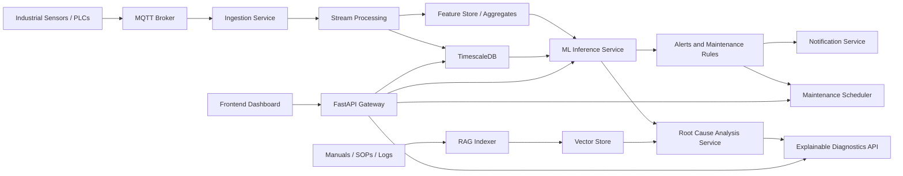

# Auravance Backend Architecture

## Goal

Auravance is a backend-first predictive maintenance platform for industrial assets. The backend needs to:

1. Ingest high-frequency telemetry from machines and PLC-connected sensors.
2. Detect anomalies in near real time.
3. Predict failures and remaining useful life (RUL).
4. Generate explainable diagnostics using equipment manuals and historical maintenance data.
5. Trigger maintenance workflows, alerts, and dashboards.

## Backend Strategy

Build the backend as a modular platform with five main layers:

1. Edge and ingestion layer
2. Streaming and storage layer
3. ML inference and analytics layer
4. Knowledge and diagnostics layer
5. Operational API and workflow layer

This lets us ship a usable monitoring system early, then add prediction quality and automation depth without reworking the core.

## Recommended Stack

- API: FastAPI
- Background jobs: Celery or Dramatiq
- Message broker: MQTT for device ingress, Redis or RabbitMQ for internal jobs
- Time-series storage: TimescaleDB on PostgreSQL
- Metadata and transactional data: PostgreSQL
- Object storage: S3-compatible bucket for model artifacts, manuals, and reports
- Vector store: pgvector in PostgreSQL for the first version
- Model serving: Python services wrapping XGBoost, LSTM, Isolation Forest
- RAG pipeline: FastAPI worker plus embedding model and vector search
- Realtime dashboard push: WebSocket or Server-Sent Events

## High-Level Architecture



## Core Services

### 1. Ingestion Service

Responsibilities:

- Subscribe to MQTT topics per plant, line, asset, and sensor.
- Validate incoming payloads.
- Normalize timestamps, units, and sensor keys.
- Persist raw telemetry and publish internal events for downstream consumers.

Example topic pattern:

`plants/{plant_id}/lines/{line_id}/assets/{asset_id}/telemetry`

Payload shape:

```json
{
  "timestamp": "2026-05-15T14:22:31Z",
  "asset_id": "compressor-17",
  "metrics": {
    "temperature_c": 84.2,
    "vibration_rms": 0.63,
    "pressure_bar": 5.2,
    "current_a": 11.7
  }
}
```

### 2. Stream Processing Layer

Responsibilities:

- Window and aggregate telemetry.
- Handle missing values and noise filtering.
- Compute derived features for inference.
- Push the latest feature vectors to the prediction pipeline.

Derived features can include:

- Rolling mean and standard deviation
- Vibration trend slope
- Temperature delta over baseline
- Frequency-domain features if vibration spectrum is available
- Sensor drift indicators

### 3. ML Inference Service

This should be split into three prediction tasks:

#### Anomaly Detection

- Model: Isolation Forest for early unsupervised detection
- Input: recent feature windows
- Output: anomaly score, anomaly label, confidence

#### Failure Prediction

- Models: XGBoost for tabular risk scoring and LSTM for time-sequence degradation patterns
- Input: asset state features plus time windows
- Output: failure probability by horizon such as 24h, 72h, 7d

#### RUL Prediction

- Model: sequence model or survival/regression model
- Input: degraded operating history and maintenance context
- Output: estimated hours or cycles remaining plus confidence band

Why this split matters:

- Isolation Forest gives fast baseline coverage even when labeled failure data is limited.
- XGBoost handles engineered features well and is easier to explain.
- LSTM captures temporal degradation patterns missed by static models.
- RUL needs its own target and validation, not just a repackaged classification score.

### 4. RAG-Based Root Cause Analysis

Purpose:

- Make predictions explainable and actionable for technicians.

Sources:

- Equipment manuals
- SOP documents
- Maintenance work orders
- Incident logs
- Sensor threshold guides

Pipeline:

1. Parse documents into chunks.
2. Create embeddings.
3. Store chunks in pgvector.
4. When an anomaly or prediction fires, retrieve relevant context by asset type, fault code, and symptom pattern.
5. Send structured context to the LLM to produce:
   - likely causes
   - impacted subsystems
   - recommended checks
   - maintenance actions
   - confidence caveats

### 5. Alerting and Maintenance Workflow

Responsibilities:

- Convert model outputs into operational actions.
- Suppress noisy repeat alerts.
- Escalate by severity and SLA.
- Create maintenance recommendations and schedules.

Rules example:

- If anomaly score is high for 3 consecutive windows, trigger an inspection alert.
- If failure probability within 72 hours exceeds threshold, create a priority work order.
- If RUL falls below configured hours, recommend maintenance scheduling in the next available slot.

## Suggested Data Model

### Relational Tables

- `plants`
- `lines`
- `assets`
- `sensors`
- `telemetry_ingestion_log`
- `maintenance_events`
- `alert_rules`
- `alerts`
- `work_orders`
- `model_registry`
- `documents`
- `document_chunks`

### Time-Series Tables

- `telemetry_raw`
- `telemetry_aggregates_1m`
- `telemetry_aggregates_5m`
- `asset_feature_snapshots`
- `prediction_events`

## API Surface

### Asset and Topology

- `GET /api/v1/assets`
- `GET /api/v1/assets/{asset_id}`
- `POST /api/v1/assets`

### Telemetry

- `POST /api/v1/telemetry/ingest`
- `GET /api/v1/telemetry/assets/{asset_id}/latest`
- `GET /api/v1/telemetry/assets/{asset_id}/history`

### Predictions

- `GET /api/v1/predictions/assets/{asset_id}/latest`
- `POST /api/v1/predictions/assets/{asset_id}/score`

### Diagnostics

- `POST /api/v1/diagnostics/root-cause`

### Alerts and Maintenance

- `GET /api/v1/alerts`
- `POST /api/v1/alerts/rules`
- `POST /api/v1/work-orders`
- `POST /api/v1/maintenance/schedule`

## Request Flow

### Real-Time Monitoring Flow

1. Sensor publishes telemetry to MQTT.
2. Ingestion service validates and stores raw readings.
3. Stream processor computes rolling features.
4. Inference service scores anomaly, failure risk, and RUL.
5. Rules engine decides whether to create an alert or work order.
6. API exposes latest state to the dashboard.

### Explainable Diagnostics Flow

1. Prediction event or technician request hits diagnostics API.
2. Relevant manuals and maintenance context are retrieved from the vector store.
3. Root cause analysis service composes structured evidence.
4. LLM returns explainable recommendations with cited source chunks.

## Service Boundaries for Version 1

Keep version 1 as a modular monolith with clear internal boundaries:

- `api`
- `ingestion`
- `analytics`
- `ml`
- `rag`
- `alerts`
- `scheduler`

Why:

- Faster to build and debug.
- Easier schema evolution.
- Lower operational overhead for an early product.
- Easier local development while models and workflows are still changing.

Split into separate deployable services later if throughput or team size demands it.

## Implementation Phases

### Phase 1: Core Platform

- FastAPI service
- PostgreSQL plus TimescaleDB
- MQTT ingestion
- Telemetry storage
- Asset management APIs
- Basic alert rules
- Simple dashboard endpoints

### Phase 2: Early Intelligence

- Isolation Forest anomaly detection
- Feature generation jobs
- Prediction event storage
- Alert deduplication and severity logic

### Phase 3: Predictive Models

- XGBoost failure risk scoring
- LSTM sequence inference
- Model registry and versioned artifacts
- Offline training pipeline

### Phase 4: Explainability

- Document ingestion
- pgvector indexing
- RAG diagnostics API
- Evidence-backed recommendations

### Phase 5: Maintenance Automation

- Work order generation
- Maintenance scheduling
- Notification integrations
- SLA and escalation policies

## How I Would Build It

1. Start with the domain model and telemetry ingestion contracts.
2. Build storage and retrieval before advanced ML so we have clean historical data.
3. Add anomaly detection first because it is useful with limited labels.
4. Layer in XGBoost failure scoring once feature pipelines are stable.
5. Add LSTM and RUL after enough sequence history is available.
6. Build RAG only after document ingestion and chunking are reliable.
7. Add maintenance automation after alert quality is acceptable.

## Key Engineering Decisions

### Why FastAPI

- Good fit for Python ML ecosystem
- Strong async support for APIs and streaming-adjacent work
- Easy integration with Pydantic validation and background workers

### Why PostgreSQL plus TimescaleDB

- One operational backbone for metadata, telemetry, and vectors
- TimescaleDB handles time-series queries efficiently
- pgvector keeps the first RAG version simple

### Why MQTT

- Standard for IoT and industrial telemetry
- Lightweight and well suited for edge-device communication

## Risks to Design Around

- Data quality is usually the first failure point, not the model.
- Label scarcity can make supervised failure prediction look better offline than it performs in production.
- Alert fatigue will kill adoption if thresholds and suppression are weak.
- Manual documents are messy, so RAG quality depends heavily on chunking and metadata.
- RUL predictions need careful calibration and should always expose confidence or uncertainty.

## Immediate Next Build Step

Implement a backend skeleton with:

- FastAPI app
- API routers
- MQTT ingestion interface
- service layer for predictions, diagnostics, and scheduling
- typed request and response schemas

That gives us a clean base to start wiring real storage, brokers, and models.
