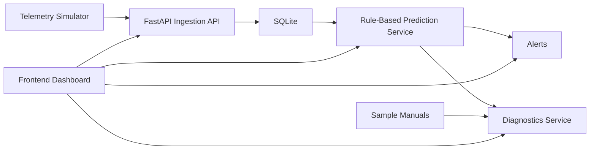

# Auravance Demo Backend Architecture

## Why Simplify

For the demo phase, the goal is to prove the product experience, not build production infrastructure. We do not need real sensors, MQTT, streaming systems, or deployed ML pipelines yet.

## Demo Architecture

## Components

### 1. Telemetry Simulator

- A Python script sends fake sensor readings every few seconds.
- We simulate healthy and failing behavior for a few demo assets.
- This replaces real sensor hardware during the MVP.

### 2. FastAPI Backend

- Receives telemetry through a normal REST endpoint.
- Exposes APIs for assets, telemetry history, predictions, alerts, and diagnostics.
- Keeps the project easy to run locally.

### 3. SQLite Storage

- Stores assets, telemetry, and generated alerts.
- Good enough for a demo and removes infrastructure overhead.

### 4. Rule-Based Prediction Engine

- Produces anomaly score, failure probability, and estimated RUL from simple thresholds and recent trends.
- This lets the application behave intelligently before trained models are added.

### 5. Diagnostics Layer

- Maps the dominant signal pattern to likely causes and recommended actions.
- Uses sample knowledge files to mimic the explainability layer we will later replace with real RAG.

## What We Are Deliberately Skipping

- MQTT
- Real-time stream processors
- Kubernetes or microservices
- Model training pipeline
- Production auth and tenancy
- Vector database

## MVP Build Order

1. Simulated telemetry
2. Telemetry storage
3. Prediction scoring
4. Alerts
5. Diagnostics
6. Frontend dashboard

## Upgrade Path Later

Once the demo works well, we can replace parts without changing the product story:

- simulator -> MQTT or real edge devices
- SQLite -> PostgreSQL and TimescaleDB
- rules -> XGBoost, LSTM, Isolation Forest
- file-based diagnostics -> RAG over manuals and work orders
